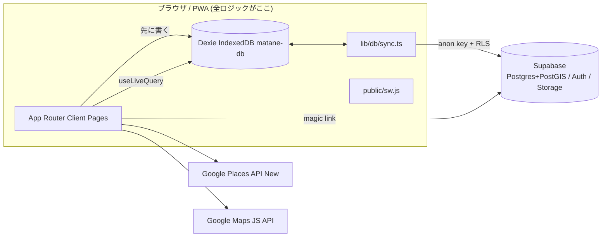
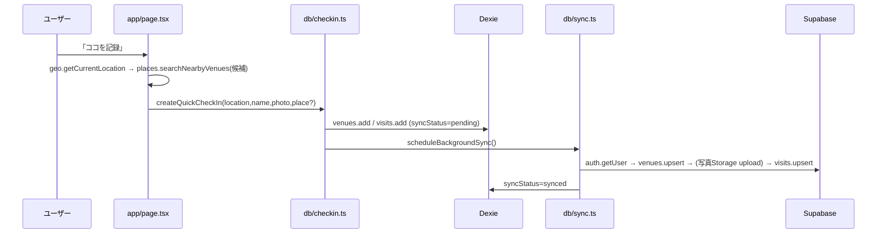

# 02 アーキテクチャとコード地図

## 1. 全体構成

- 確認済み: Server Action / Route Handler / API ルート / `middleware`/`proxy` は**無い**。Next.js は静的配信＋クライアントレンダリング用途。
- サーバー側の認可は Supabase の RLS と SECURITY DEFINER 関数のみ。

## 2. データの流れ（ココを記録）

## 3. ディレクトリ

| パス | 役割 |
| --- | --- |
| `src/app/page.tsx`(670行) | ホーム。2 ボタン、各ダイアログ、今日どこ行く？カード、アンドゥ |
| `src/app/timeline/` | あしあと（月別、カテゴリ/目的フィルタ、削除） |
| `src/app/wishlist/` | 気になる（Googleマップインポート） |
| `src/app/stats/`, `map/(MapClient)` | わたしデータ、ちかく |
| `src/app/venues/[venueId]/`(`VenueDetailClient`), `visits/[visitId]/`, `visits/[visitId]/register/` | 店舗詳細、訪問詳細、二次登録 |
| `src/app/group/`, `settings/`, `login/` | グループ、設定、ログイン |
| `src/components/` | `BottomNav`、`ChoiceChips`、`ConfirmDialog`、`PlaceCandidateList`、`AuthStatus`、`PartnerAvatar`、`Skeleton`、`ServiceWorkerRegister` |
| `src/lib/db/localDb.ts` | Dexie スキーマ(v1〜v5)、`clearLocalData()` |
| `src/lib/db/checkin.ts`(451行) | **書き込み系の中核**（登録・削除・復元・気になる・インポート） |
| `src/lib/db/queries.ts` | `useLiveQuery` による読み取りフック、`useSuggestedVenue` |
| `src/lib/db/sync.ts`(421行) | push/pull/重複解消/削除キュー処理 |
| `src/lib/db/groups.ts` | グループ作成・招待・参加・脱退・メンバー取得、`isOwnVisit` |
| `src/lib/auth/AuthProvider.tsx` | セッション管理、ログイン時 pull/push |
| `src/lib/places.ts` | Google Places 呼び出し、カテゴリ判定 |
| `src/lib/googleMapsImport.ts` | Takeout CSV / KML パーサ |
| `src/lib/export.ts` | CSV/ICS 生成（CSV インジェクション対策済み） |
| `src/lib/storage.ts`, `photo.ts` | 写真アップロード/削除、圧縮 |
| `src/lib/{geo,stats,time,datetimeLocal,commuteSettings,sessionFlags,errors,useGoogleMapsScript,useOnlineStatus}.ts` | 補助 |
| `src/config/commute.ts` | 終電計算（営業日=5時起点） |
| `src/constants/choices.ts` | 選択肢の単一情報源 |
| `src/types/models.ts` | 型（Supabase の自動生成型は無い） |
| `src/test-utils/fakeSupabase.ts` | テスト用スタブ |
| `supabase/schema.sql` | DB の唯一の定義 |
| `e2e/` | Playwright 6 本 |
| `public/` | SW、manifest、アイコン |

## 4. ルーティング

`/`、`/timeline`、`/wishlist`、`/stats`、`/map`、`/venues/[venueId]`、`/visits/[visitId]`、`/visits/[visitId]/register`、`/group`、`/settings`、`/login`。ルート保護なし（ゲスト許可）。`BottomNav` は layout に常設。

## 5. 状態管理・データ取得

- 読み取り: Dexie `useLiveQuery`（`queries.ts`）。ローカルが画面の唯一の真実で、クラウドは同期先。
- 書き込み: `checkin.ts` が Dexie に `syncStatus:"pending"` で書き `scheduleBackgroundSync()`。
- 同期トリガー: 起動時・`online` イベント（`registerSyncListeners`）、書き込み直後、ログイン時（`AuthProvider`: `SIGNED_IN` で pull、セッションがあれば push、起動時に既存セッションなら pull）。
- 削除: 同期済み行は `pendingVisitDeletes`/`pendingVenueDeletes` キューへ。
- UI 状態の localStorage: `matane:commuteOverrides`、`lastOtpSentAt`、`mapFilter`、`savedToast`、`seenNavGuide`、`timelineFilter`、`timelinePurposeFilter`。

## 6. 認証・認可

- 認証: Supabase マジックリンク（`signInWithOtp`、`emailRedirectTo=window.location.origin`）。パスワードなし。`AuthProvider` が `getSession`/`onAuthStateChange`。
- 認可: RLS（[04](./04_data_api_and_integrations.md)）。クライアントは `created_by`/`user_id` を自分の ID で付与。

## 7. エラー処理・ログ

`console.warn` が中心。`lib/errors.ts` がネットワークエラーを日本語化。外部エラートラッキング無し。

## 8. 変更時の波及

| 変更 | 波及先 |
| --- | --- |
| Venue/Visit に列追加 | `types/models.ts`、`localDb.ts`(version up)、`sync.ts` の `toVenueRecord/fromVenueRecord/toVisitRecord/fromVisitRecord`（**手書きマッピング**）、`checkin.ts` の `restoreVisit` 等、`schema.sql`、`export.ts` |
| 選択肢追加 | `constants/choices.ts`（型派生）＋ `ALCOHOL_ICONS` などの Record |
| RLS 変更 | `schema.sql`（`drop policy if exists` → `create policy` の形を維持）、`groups.test.ts`/`fakeSupabase.ts` |
| テーブル追加 | Dexie の新 version、`clearLocalData` は全テーブル走査なので追従不要 |
| SW キャッシュ戦略 | `CACHE_NAME`（現 `matane-shell-v4`）を上げる |

## 9. 新機能追加の定石

PRD の原則に反しないか確認 → `choices.ts`/`models.ts` → `localDb` version → `checkin.ts`/`queries.ts` → `sync.ts` マッピング → `schema.sql`（冪等）→ UI → テスト。AI 機能を足す場合はサーバー層（Route Handler/Server Action）の新設と API キー管理が必要（現状ゼロ）。
